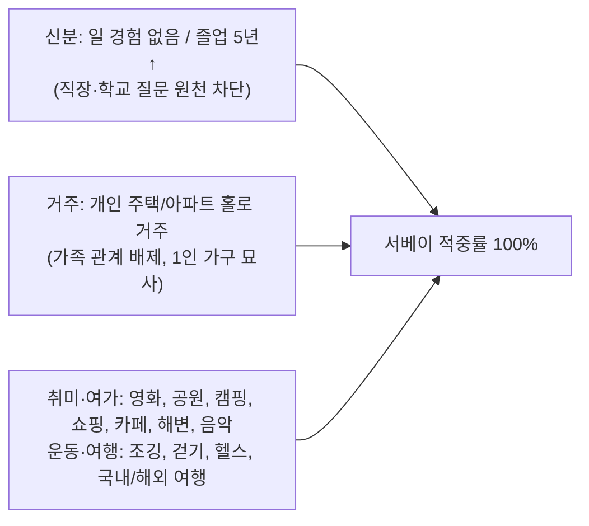
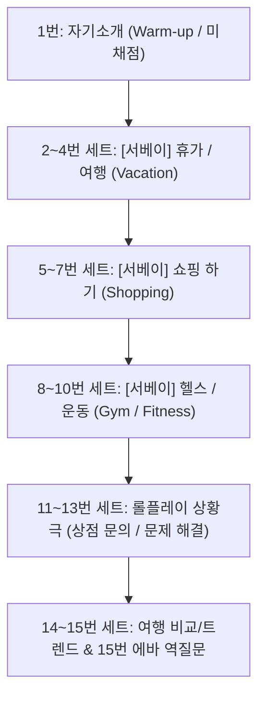
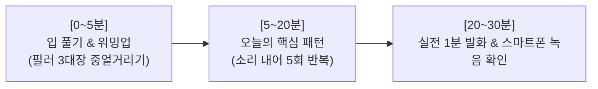
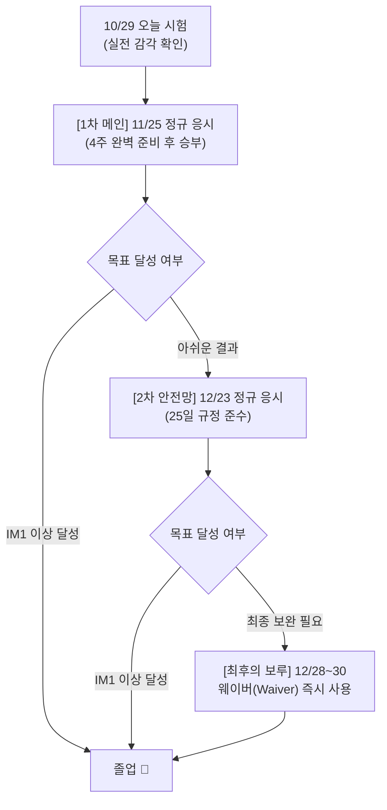

# 🎯 OPIc 시험 복기 및 차기 시험 완벽 대비 전략서

> **문서 버전:** v2.0 (전면 재정비)  
> **시험 응시일:** 2026년 10월 29일  
> **선택 난이도:** 3 (3-3)  
> **최종 목표:** 12월 31일 이전 IM1 ~ IM2 취득  

---

## 1. 응시자 프로필 및 서베이(Background Survey) 분석

사용자가 선택한 설문 항목은 직장·학교 등 고난도 질문을 원천 배제하고 일상 주제로만 압축한 **'오픽 표준 황금 서베이'**입니다.



> [!TIP]
> **서베이 변경 불필요:** 10/29 시험의 모든 일반 문항(2~10번, 14~15번)이 위 서베이 항목에서 100% 적중하여 출제되었습니다. 다음 시험에서도 **동일한 서베이 구성을 그대로 유지**합니다.

---

## 2. 10/29 시험 15문항 완벽 복원 (Exam Set Reconstruction)

오픽은 3문제가 하나의 세트(콤보)로 묶여 출제됩니다. 복기된 단서들을 기반으로 재구성한 전체 15문항 구조는 다음과 같습니다.



### 15문항 상세 복원표

| 문항 번호 | 주제 (Topic) | 질문 성격 | 핵심 질문 내용 및 단서 복원 |
| :---: | :---: | :---: | :--- |
| **1번** | **자기소개** | 워밍업 (미채점) | 에바에게 간단한 자기소개 (2문장 발화) |
| **2번** | **휴가 (Vacation)** | 서베이 콤보 1 | *"In the background survey... you go on vacations."* 좋아하는 휴가지 묘사 |
| **3~4번** | **휴가 경험** | 서베이 콤보 1 | 기억에 남는 휴가 경험 또는 최근 휴가 중 있었던 일 |
| **5번** | **쇼핑 (Shopping)** | 서베이 콤보 2 | *"In the background survey... you enjoy shopping."* 주로 가는 쇼핑몰/가게 묘사 |
| **6~7번** | **쇼핑 경험/비교** | 서베이 콤보 2 | 최근에 산 물건 또는 상점 쇼핑 vs 온라인 쇼핑 비교 (`different` 단서) |
| **8번** | **헬스 (Health/Gym)** | 서베이 콤보 3 | *"In the background survey... you work out at a gym."* 다니는 헬스장 묘사 |
| **9~10번** | **헬스 경험/계기** | 서베이 콤보 3 | 운동을 처음 시작하게 된 계기 또는 운동 중 기억에 남는 일 |
| **11번** | **상황극 질문하기** | 롤플레이 콤보 4 | 상점/여행사에 전화해 3~4가지 정보 문의 (*"Call the store and ask..."*) |
| **12번** | **문제 해결/대안** | 롤플레이 콤보 4 | 물건 하자 또는 일정 문제 발생 시 2~3가지 대안 제시 |
| **13번** | **유사 과거 경험** | 롤플레이 콤보 4 | 11~12번과 유사하게 과거에 문제를 겪었던 본인의 경험 |
| **14번** | **여행 비교/트렌드** | 복합 콤보 5 | 국내 여행 vs 해외 여행의 차이점 비교 (*"different types of travel"*) |
| **15번** | **에바 역질문 롤플레이** | 복합 콤보 5 | *"I also like to take trips to famous places. Ask me 3~4 questions."* |

---

## 3. 채점관 관점에서의 4대 실전 이슈 분석

### ① "15번 문제의 정체": 에바(Eva) 역질문 롤플레이
* **단서:** `trip`, `famous`, `many questions (Ask me 3~4 questions)`
* **분석:** 오픽의 대표적인 후반부 롤플레이 유형입니다. 상황극 외에도 면접관에게 직접 질문을 던지는 역질문형 롤플레이가 출제됩니다.
* **평가:** 질문의 의도를 완전히 맞추지 못하고 일반 여행 이야기로 답했더라도, 여행 관련 영어를 끊김 없이 구사했다면 유창성 부분 점수가 인정됩니다.

### ② "루틴 문제가 안 나온 이유": 정상적인 랜덤 콤보
* **분석:** 많은 학원에서 `[묘사 - 루틴 - 경험]`을 공식처럼 가르치지만, 실제 시험 알고리즘은 `[묘사 - 경험 - 경험]`이나 `[묘사 - 비교 - 경험]` 등 다양한 조합으로 출제됩니다. 루틴이 0문제 출제된 것은 지극히 정상적인 배정입니다.

### ③ "경험/비교 질문에 루틴으로 답변한 영향"
* **비교(Comparison):** 난이도 3 응시자에게 비교 문제는 상위 등급(IM3~IH) 판별용 보너스 문항이므로, 제대로 비교하지 못했더라도 IM1~IM2 취득에는 치명적이지 않습니다.
* **오프토픽 우려:** 질문 주제(쇼핑/여행/운동)의 범주 내에서 발화했으므로, 완전한 0점이 아니라 **"의사소통 및 발화량 점수"**가 반영됩니다. 침묵(Silence)한 것보다 백배 나은 선택이었습니다.

### ④ "7문제 스킵의 냉정한 영향"
* **현실적 진단:** 오픽은 미국 ACTFL 공인 원어민 채점관이 15문제를 순차 청취하여 평가합니다. 15문제 중 7문제를 스킵하면 **평가할 음성 표본(Data) 자체가 절반으로 감소**합니다.
* **예상 등급:** **`NH ~ IL`** 범위가 유력하며, 답변한 7~8개 문제의 발화 질(완전한 문장, 발음, 억양)이 우수했을 경우에 한해 **`IM1 턱걸이`**가 가능합니다.

---

## 5. 실전 트러블 3대 원인 및 맞춤형 해결 솔루션

### 🚨 수험생이 직접 체감한 3대 애로사항
1. **주변 사람들의 소리:** 옆 사람들의 발화 소음 때문에 집중력 및 기억력이 급격히 저하됨.
2. **청취 한계:** 문장 전체가 들리지 않고 키워드 한두 단어만 간신히 들림.
3. **롤플레이 미인지:** 문제 지시문이 길거나 생소하여 롤플레이 상황 자체를 인지하지 못함.

---

### 💡 수험생이 찾아낸 '골든 타임(Pause) 전략'의 타당성 검증
> **수험생 아이디어:**  
> *"15문제 다 말해도 15분도 안 걸리니 시간이 20분 이상 남는다. Next를 누른 뒤 다음 문제 재생 버튼을 누르기 전까지는 녹음이 안 되니, 다음에 나올 문제를 미리 예상하고 한두 번 입으로 말해보며 준비한 뒤 재생을 누르자."*

> [!TIP]
> **검증 결과: 오픽 1타 강사들도 강력 추천하는 최상급 실전 기술입니다!**  
> 오픽은 개별 문항당 타이머가 아니라 **'전체 40분 통합 타이머'**로 운영됩니다. Next를 누르고 다음 문제의 재생(Play) 버튼을 누르기 전까지 **30초~1분 동안 마인드 컨트롤을 하고 키워드를 입으로 중얼거리더라도 시스템상 아무런 감점이나 제재가 없습니다.**

---

### 🛠️ 실전 3대 애로사항 완벽 극복 솔루션

#### 1. 주변 소음 차단 및 페이스 조절법
* **헤드셋 볼륨 최대화:** 시험 시작 전 오디오 점검 때 볼륨을 최대로 높여 주변 소리를 헤드셋 소리로 덮습니다.
* **1~2분 늦게 시작하기 (소음 피크 피하기):** 시험 시작 버튼을 남들보다 1분 정도 늦게 누릅니다. 남들이 1~2번을 미친 듯이 소리 지르며 답변하는 '초반 소음 피크' 타이밍을 비껴갈 수 있습니다.
* **남는 시간(Pause 타임) 활용:** 옆 사람이 너무 크게 떠들고 있다면, 재생 버튼을 누르지 말고 옆 사람 답변이 끝날 때까지 20~30초 기다렸다가 조용해졌을 때 재생 버튼을 누르세요.

#### 2. 청취(리스닝) 한두 단어 대처법: "2단어만 잡으면 성공"
* 난이도 3은 문장 전체를 다 들을 필요가 전혀 없습니다.
* **무조건 2번 듣기 (Replay 100% 활용):** 1번째 들을 때는 주제 명사(`shopping`, `gym` 등)를 잡고, 5초 내 Replay를 눌러 2번째 들을 때는 **마지막 문장의 의문사/시제(`What`, `Where`, `Did you`)**만 확인합니다.
* 오픽은 키워드 2개(예: `shopping` + `different`)만 들리면 답변을 시작할 수 있습니다.

#### 3. 롤플레이 1초 만에 감지하는 '시그널 워드'
롤플레이 지문을 다 해석하려고 하지 말고, 에바가 다음 단어를 말하면 무조건 롤플레이로 판정합니다:
* **11번:** `"Call"` 또는 `"Ask 3 or 4 questions"` ➔ 상점/친구에게 전화해서 질문 3개 던지기
* **12번:** `"Problem"` 또는 `"Explain the situation"` ➔ 문제 발생 사과하고 대안 2개 주기
* **15번:** `"Ask me"` ➔ 에바에게 Where, Who, What 질문 3개 던지기

---

## 6. 11/25 대비 '하루 30분' 4주 완성 학습 플랜

> **시간 배분 원칙:** 눈으로 읽는 공부 0분, **입으로 소리 내어 뱉는 훈련 30분**  
> 오픽은 머리가 아니라 '입 근육'으로 보는 시험입니다. 하루 30분이면 충분합니다.



### ⏱️ 매일 30분 고정 루틴 구조
1. **0~5분 (워밍업):** 필러 3대장(`Well...`, `You know...`, `To be honest...`) 입으로 중얼거리며 뇌 깨우기
2. **5~20분 (핵심 패턴 훈련):** 오늘 정한 핵심 문장 3~4개를 감정을 실어 소리 내어 10번 반복
3. **20~30분 (실전 녹음 & 점검):** 타이머 1분을 켜고 스마트폰에 녹음해 본 뒤, 끊김 없는지 자가 확인

---

### 📅 주차별 4주 세부 커리큘럼 (월~금 기준, 주말 가벼운 복습)

#### [1주차] 스킵 0개 만들기: "만능 회피 구문" 몸에 익히기
* **목표:** 어떤 모르는 질문이 나와도 당황하지 않고 40초를 떠들 수 있는 방어막 형성
* **Day 1~2:** 시간 벌기 필러 훈련 (*"Well, Eva... to be honest with you, that's a tough question."*)
* **Day 3~4:** 주제 돌리기 전환 공식 (*"Actually, I don't have that experience. So let me tell you about my routine."*)
* **Day 5:** 1단계 + 2단계 연결해서 40초 채우는 실전 녹음 연습

#### [2주차] 서베이 3대 만능 스토리라인 정복
* **목표:** 여행, 쇼핑, 헬스, 공원, 카페 등 모든 주제를 3개 대본으로 통합 돌려막기
* **Day 6~7: [야외/힐링]** 공원, 조깅, 걷기 (*"날씨 좋은 날 밖에서 음악 듣고 산책하며 스트레스 푼다."*)
* **Day 8~9: [실내/휴식]** 카페, 집, 음악, 영화 (*"커피 마시며 스마트폰 보고 음악 듣는 여유를 즐긴다."*)
* **Day 10: [외출/활동]** 쇼핑, 여행 (*"친구들과 유명한 곳 가서 맛있는 거 먹고 사진 찍는다."*)

#### [3주차] 롤플레이 2대 공식 (11~12번 & 15번)
* **목표:** 롤플레이 지문 다 안 듣고도 "질문 3개"와 "대안 2개" 자동으로 뱉기
* **Day 11~12 (11번 질문 3개):** *"Hi, I'm calling to ask a few questions. Where is it? How much is it? What time do you close?"*
* **Day 13~14 (12번 문제/대안):** *"I'm sorry, I have a problem. Can I change it? Or can I get a refund?"*
* **Day 15 (15번 에바 역질문):** *"Oh, you like it too? Where do you usually go? Who do you go with? Why do you like it?"*

#### [4주차] 과거 시제(Past Tense) 자동화 & '포즈 전략' 모의 실전
* **목표:** 과거형 동사 입에 장착하기 + 11/25 시험장 시뮬레이션
* **Day 16~17:** 과거 동사 5대장 입 훈련 (`went`, `saw`, `ate`, `had`, `bought`, `felt`)
* **Day 18~19:** **포즈(Pause) 전략 적용 연습:** 문제 재생 전 30초 생각하고 말하는 실전 훈련
* **Day 20 (시험 직전):** 1번부터 15번까지 1세트 통으로 모의고사 시뮬레이션

---

## 7. 12/31 데드라인 대비 응시 로드맵

오픽 규정(25일 재응시 제한)과 **웨이버(평생 1회 25일 면제권)**를 전략적으로 결합하여 최대 3번의 기회를 확보합니다.



> [!IMPORTANT]
> **웨이버는 마지막 순간까지 아껴두세요!**  
> 웨이버를 11월에 써버리면 12월 말에 추가 기회를 만들 수 없습니다. 웨이버는 **'12월 말 비상 보험'**으로 쥐고 가야 심리적으로 안정된 상태에서 시험을 볼 수 있습니다.

---

## 5. 11/25 시험 대비 4주 실전 액션 플랜

목표는 단 하나, **"스킵 0개 달성 + 기본 문장으로 1분 채우기"**입니다.

### 📅 주차별 집중 훈련 과제

| 주차 | 목표 과제 | 세부 행동 지침 |
| :---: | :--- | :--- |
| **1주차** | **'스킵 0개' 탈출 훈련** | 준비 안 된 문제/못 알아들은 문제가 나와도 40초를 버티는 **만능 회피 구문** 암기 및 체화 |
| **2주차** | **서베이 3대 그룹 스크립트** | 야외(공원/조깅), 실내(카페/음악/집), 외출(쇼핑/여행) 만능 스토리라인 완성 |
| **3주차** | **롤플레이 2대 공식 정복** | 11번(질문 3개), 12번(대안 제시), 15번(에바에게 Where/Who/What 역질문) 패턴 장착 |
| **4주차** | **과거 시제 자동화 & 실전** | `went`, `saw`, `ate`, `had`, `felt` 입에 붙이기 + 15문항 모의고사 시뮬레이션 |

---

## 6. 비상 탈출용 만능 템플릿 (스킵 방지 치트키)

어떤 문제가 나와도 절대 Next를 누르지 않고 40초를 채우는 3단계 공식입니다.

````carousel
```text
[1단계: 솔직 고백 & 시간 벌기 (필러)]
"Well, Eva... to be honest with you, 
I don't really have a special experience about this.
So it's quite difficult to explain..."
```
<!-- slide -->
```text
[2단계: 내가 아는 주제로 자연스럽게 전환]
"Actually, as I mentioned in the previous question,
I usually just stick to my routine. 
So let me tell you about what I normally do."
```
<!-- slide -->
```text
[3단계: 준비해 간 만능 루틴 3~4문장 붙이기]
"Whenever I have free time, I usually go to the park or cafe.
I listen to my favorite music with my smartphone.
It really helps me relieve stress. That's pretty much all."
```
````

---

## 7. 행동 체크리스트

- [ ] **11월 초:** 10/29 시험 성적 발표 확인 (등급 확인 후 멘탈 정비)
- [ ] **11월 1~7일:** 1단계 만능 회피 구문 30초 말하기 입 훈련
- [ ] **11월 8~14일:** 서베이 3대 그룹(야외/실내/외출) 본인 이야기로 정리
- [ ] **11월 15~21일:** 롤플레이 11-12번 및 15번 의문문 패턴 완성
- [ ] **11월 25일:** **1차 정규 시험 응시 (스킵 0개 달성)**
